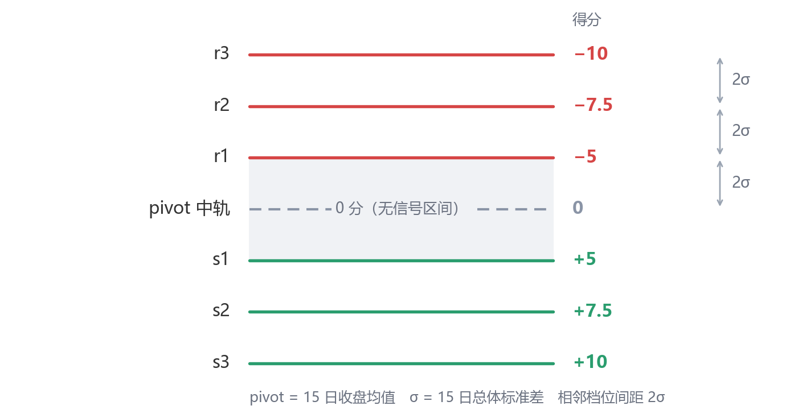
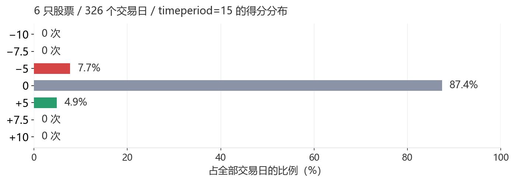

# 布林带做支撑阻力：六个价位里只有两个在触发

`factor/boll_support_resistance.py` 用布林带算支撑位和阻力位，给做 T 辅助。思路是把布林带三轨按带宽向外各推一档，凑出六个价位，价格贴近哪一档就给对应的分。

拿 6 只股票的日 K 实测，七档得分里只有三档出现过。

## 轨道怎么来的

布林带由中轨和上下轨构成：中轨是 N 日收盘均值,上下轨是中轨加减 2 倍标准差。代码把「中轨到上轨」这段距离当成一档带宽，向上、向下各外推两次：

- pivot = 中轨
- r1 = 上轨，r2 = 上轨 + 1 倍带宽，r3 = 上轨 + 2 倍带宽
- s1 = 下轨，s2 = 下轨 − 1 倍带宽，s3 = 下轨 − 2 倍带宽

上轨本身就是中轨 + 2σ，带宽等于 2σ，所以六个价位换算下来正好落在 ±2σ、±4σ、±6σ 上，相邻档位等距。



核心计算如下：

```python
upper, middle, lower = talib.BBANDS(
    price_series,
    timeperiod=self.timeperiod,
    nbdevup=self.nbdevup,
    nbdevdn=self.nbdevdn,
)
# 布林带上下带宽（nbdev * std）
band_up: np.ndarray = upper - middle
band_dn: np.ndarray = middle - lower

return pd.DataFrame(
    {
        "pivot": middle,
        "r1": upper,
        "r2": upper + band_up,
        "r3": upper + 2 * band_up,
        "s1": lower,
        "s2": lower - band_dn,
        "s3": lower - 2 * band_dn,
    }
)
```

两个口径细节值得记下来。talib.BBANDS 的中轨是简单均值，σ 用的是**总体标准差**，实测与 `pandas.rolling(15).std(ddof=0)` 完全一致，换成 `ddof=1` 会偏大约 3.5%。另外 BBANDS 的 lookback 是 `timeperiod − 1`，15 根窗口下第 15 根 K 线才产出第一个有效值。代码里 `len(stock_array) < self.timeperiod` 就返回空表，这个闸门卡得刚好够用。

## 打分规则

价格在中轨之上靠近阻力位，给负分（卖出）；中轨之下靠近支撑位，给正分（可做多）。七个档位，得分取 ±10、±7.5、±5 和 0：

```python
score: float = 0.0
if p == 0.0 or pd.isna(p):
    return 0.0
if price >= p:  # 行情向上，接近阻力位 → 卖出信号（负分）
    if r3 > 0 and price >= r3:  # 超出最大阻力位，可以卖出
        score = -10.0
    elif r2 > 0 and price >= r2:
        score = -7.5
    elif r1 > 0 and price >= r1:
        score = -5.0
else:
    if s3 > 0 and price <= s3:  # 超卖，可做多
        score = 10.0
    elif s2 > 0 and price <= s2:
        score = 7.5
    elif s1 > 0 and price <= s1:
        score = 5.0
return score
```

## 实测：只有 ±5 在触发

取 6 只股票、2026-05-01 至 2026-09-24 的日 K，按 `timeperiod=15` 逐日滚动计算，去掉窗口预热期后共 326 个交易日样本：



| 档位 | 得分 | 触发次数 | 占样本比例 |
| --- | --- | --- | --- |
| r3 | −10 | 0 | 0% |
| r2 | −7.5 | 0 | 0% |
| r1 | −5 | 25 | 7.7% |
| 中轨区间 | 0 | 285 | 87.4% |
| s1 | +5 | 16 | 4.9% |
| s2 | +7.5 | 0 | 0% |
| s3 | +10 | 0 | 0% |

±10 和 ±7.5 这四档一次都没出现，87.4% 的交易日落在 0 分区间，剩下 12.6% 全部是 ±5。

## 高档位为什么碰不到

关键在于计算轨道用的窗口**包含当根价格本身**。

设前 14 根均值为 m0，当根价格为 p，令 d = p − m0。加入当根后：

- pivot = m0 + d/15，所以 p − pivot = 14d/15
- 15 个样本的总体标准差存在下界：σ ≥ (14/15)|d| / √15 = 0.241|d|

要触及 r2（中轨 + 4σ），需要 `p − pivot ≥ 4σ ≥ 0.964|d|`。而 `p − pivot` 只有 0.933|d|。0.933 小于 0.964，不等式无解，所以 **r2 及以上在 15 根窗口下不可达**，s2/s3 同理。

推广到一般情形：n 根窗口、按 m 倍 σ 外推的档位，单根价格能触及的必要条件是 `m ≤ √n`。√15 = 3.87，2σ 档（r1/s1）可达，4σ 与 6σ 档不可达。窗口开到 17 根以上，4σ 档才有理论上的可能。

需要说明的是，这里的结论针对「单根价格拉不动自己的轨道」。这正是当根参与计算的结果：价格抬上去，均值被抬高，σ 也被撑大，轨道跟着往上跑。

把轨道和判定价格错开一根（用前一日的轨道判断当日价格），档位分布会好看一些，但高档位依然稀有：

| timeperiod | 样本天数 | ±5 合计 | ±7.5 及以上 |
| --- | --- | --- | --- |
| 15 | 326 | 12.6% | 0 次 |
| 30 | 236 | 12.3% | 0 次 |
| 60 | 114 | 4.4% | 0 次 |

窗口放大到 60 根，±5 的触发率反而降到 4.4%，因为 σ 变大、轨道变宽，价格更难靠边。

## 价格取不到时会给出 +5

`score` 对中轨做了零值和 NaN 检查，但没有校验当根价格：

```python
if p == 0.0 or pd.isna(p):
    return 0.0
```

当 `price = 0`（取数缺失的常见占位）或 −1 时，`price >= pivot` 为假走 else 分支，而 `price <= s1` 为真，只要 s1 还是正数就命中 +5。实测结果：

| 当根价格 | 输出 |
| --- | --- |
| 0 | +5.0 |
| −1 | +5.0 |
| NaN | 0.0 |

NaN 之所以安全是巧合：单根 NaN 会把整个窗口的均值污染成 NaN，正好撞上已有的中轨检查。价格取 0 没有这层巧合。

对照 ADX 那个因子，那边是数据不足时产出 NaN 一路穿到 else，被判成「下跌」；这里是取数缺失返回 0，被判成「超卖可做多」。表现不同，成因一样：异常值和合法值共用同一条比较链路。

## 修法

三处，按优先级排：

1. **补价格有效性闸门。** 在 `score` 入口加 `if price <= 0: return 0.0`，与中轨的检查并列。
2. **轨道与判定价格错开一根。** 支撑阻力的本意是用历史区间判断当前价格，轨道应当用截至前一日的窗口计算，而不是把当根价格算进去再拿它判定自己。
3. **处理无效档位。** 若保留 15 根窗口，r2/r3/s2/s3 恒不触发，应当在代码里注明或直接去掉，避免后来者按七档的假设去调阈值。

这类问题不报错，返回值合法，日志干净，只是七个档位里有五个不出现。

> **免责声明**：本文为技术实现分享，涉及因子逻辑与代码均为工程实践讨论，**不构成任何投资建议**。文中数据来自 6 只股票的日 K 实测，样本区间为 2026-05-01 至 2026-09-24，不代表真实市场表现。股市有风险，投资需谨慎。
