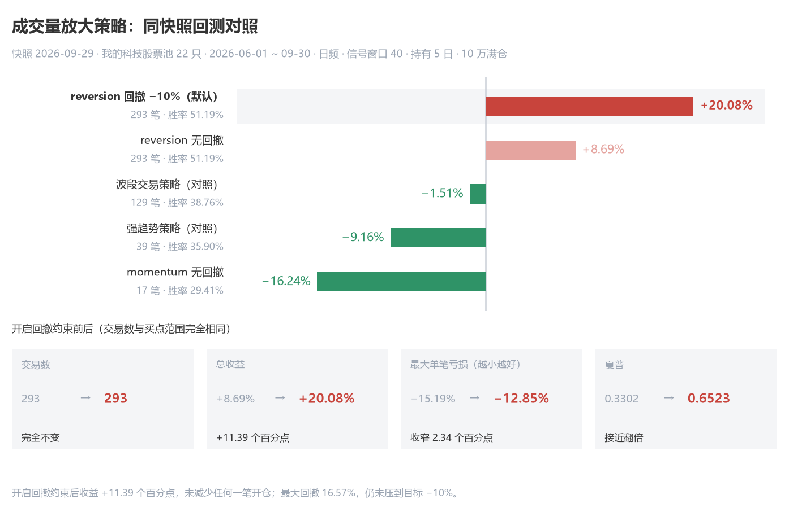

# 成交量放大策略：搭配因子按 IC 选，默认方向被回测推翻

`strategy/volume_expansion_strategy.py` 是一个日线选股、分钟触发买卖的策略，主因子是成交量放大因子，另外配一个辅助因子做确认。这篇记录两件事：搭配因子怎么从 14 个因子里选出来，以及主因子的方向最终为什么被反过来用。

## 策略结构

信号分两层，日线层用于盘前选股，分钟层用于盘中触发买入。两层都要求同一组条件：成交量因子打分达标、搭配因子给出确认、综合分不低于门槛。

需要先说明一个接口细节：成交量因子返回的是字典（含 `score`、`vol_ratio`、`signal`、`reason`），而支撑阻力、均线、ADX 这类因子返回的是 float。取值必须写 `factor.score(df)["score"]`，按 float 处理会拿到一个字典去做加法。

综合分的合成方式：两道门槛都通过给底分 5.0，再按「超过门槛多少」追加最多 5.0，量能侧权重 0.6、位置侧 0.4。方向判定集中在 `_combine` 这一处：

```python
if mode == MODE_REVERSION:
    volume_ok: bool = volume_score <= quiet_threshold
    span: float = max(quiet_threshold, 1e-6)
    volume_component: float = min(max(quiet_threshold - volume_score, 0.0) / span, 1.0)
else:
    volume_ok = volume_score >= volume_threshold
    span = max(10.0 - volume_threshold, 1e-6)
    volume_component = min(max(volume_score - volume_threshold, 0.0) / span, 1.0)
```

这是两种模式唯一的分歧点：`momentum` 要求成交量分不低于门槛，`reversion` 要求不高于门槛。其余打分、门槛、卖出逻辑完全共用。

## 搭配因子按 IC 选

搭配因子不是照着「看起来相关」挑的。在服务端日 K 样本上（43 只股票、56 个交易日、924 个「窗口 40 根」样本，2026-07-01 至 2026-09-16）算了三组量：各因子按日截面秩相关（IC）、与成交量打分的相关性、以及成交量 × 搭配因子的分档矩阵。

| 因子 | 截面 IC | t 值 | 与成交量打分相关性 |
| --- | --- | --- | --- |
| 布林带支撑/阻力位 | +0.166 | +3.43 | −0.494 |
| K线支撑/阻力位 | +0.124 | +2.74 | −0.240 |
| ROC | −0.101 |  |  |
| ADX 趋势 | −0.118 |  | 正相关 |
| 价格趋势 | −0.141 |  | 正相关 |
| 复合趋势 | −0.168 |  | 正相关 |
| 回归趋势 | −0.180 |  | 正相关 |
| 均线排列 | −0.208 |  | 正相关 |

14 个因子里只有支撑/阻力位这一族 IC 为正，并且与成交量打分负相关。这两个条件是「互补」的定义：IC 为正说明它自己有效，负相关说明它提供的是成交量因子之外的信息。趋势与动量族 IC 全负，且与成交量打分正相关 0.17 至 0.42，叠加进去只会放大同向风险，所以一个都没用。

搭配因子的门槛定在 0.0，判定用 `>=`。依据同样是实测：价格触及下方支撑轨（`boll > 0`）5 日超额 +0.97%，含「中轨下方未触轨」的 0 档是 +0.34%，而跌破轨道（`boll <= -5`）是 −0.93%。0 档与正档都不算差，负档才明显变差，门槛因此卡在两者之间。

还有一处易错：布林带取值是离散的（10 / 7.5 / 5 / 0 / −5 / −7.5 / −10），门槛两侧没有中间区间，所以「低分组 = boll <= −5、高分组 = boll >= 0」这两组恰好穷尽全样本。门槛取 `> 0` 时只在 27% 的样本上成立，等于把大部分样本丢掉。

## 主因子的默认方向被样本推翻

同一份实测里，成交量因子自己的 BUY 阈值在该样本是负超额：

| 成交量打分 | 5 日超额 | 胜率 | 样本数 |
| --- | --- | --- | --- |
| >= 6 | −0.60% | 33% |  |
| >= 4 | −1.03% | 38% | 271 |
| <= 0 | +0.46% |  |  |

按日截面 IC 为 −0.156（t = −3.19），前后半段分段同号（−1.36% / −0.90%）。分档矩阵还显示，在每一个布林带档位内，成交量分越高、后续超额越差。

正超额落在「缩量 + 价格贴着支撑」这一侧：`V < 4 且 boll >= 0` 的 5 日超额是 +1.06%。

也就是说，在这个样本里放量更接近情绪高点与派发。默认方向因此改成 `reversion`，放量从买入理由变成否决条件。正式回测的结论与离线统计一致，见下节。

## 账户回撤当成一条卖出理由

回测显示最大回撤 17.01%，目标是把组合回撤约束到 −10%。第一版实现是「账户回撤超阈值即停止开新仓」，实测被证伪：阈值取 −5% 与 −10% 的结果完全相同。原因是熔断后不再交易，权益随之不再变动，回撤也就无法收窄，一次触发等于永久停手。

改成把回撤计入卖出判定分值，不冻结开仓：

```python
# 6) 账户级回撤：账户权益自峰值回撤达 risk.max_drawdown_pct 时分值入账。
#    这是**账户级**条件，对被检查的每只股票都成立（回撤超限时整体降仓），
#    语义是「把回撤当作一条卖出理由」，不冻结开新仓。
extra["account_drawdown"] = round(float(self.account_drawdown_pct or 0.0), 2)
risk_score: float = self._risk_drawdown_score()
if risk_score < 0:
    score += risk_score
    reasons.append(
        f"账户回撤{self.account_drawdown_pct:.2f}%"
        f"达阈值{self.RISK_MAX_DRAWDOWN_PCT:.2f}%"
    )
```

回撤分值取 −6.0，与卖出阈值等值，即「账户回撤超阈值」单独一条就足以触发卖出信号。策略只看得到单只股票的行情，拿不到账户权益，所以回撤值由外部注入：实盘在 `_process_bar` 调用策略前写入，日频回测在全部信号生成后重放、达阈值当日以收盘价卖出在持仓位。

## 回测对照

同一份数据快照（2026-09-29，日 K 截至 09-28），股票池 22 只，区间 2026-06-01 至 09-30，日频，信号窗口 40 根，持有 5 个交易日，初始资金 10 万、满仓：



收益侧：

| 配置 | 交易数 | 胜率 | 总收益 |
| --- | --- | --- | --- |
| reversion，无回撤 | 293 | 51.19% | +8.69% |
| reversion，回撤 −10% | 293 | 43.00% | +20.08% |
| momentum，无回撤 | 17 | 29.41% | −16.24% |
| 强趋势策略（对照） | 39 | 35.90% | −9.16% |
| 波段交易策略（对照） | 129 | 38.76% | −1.51% |

风险侧（提前卖出 = 因回撤达阈值而被提前卖出的笔数）：

| 配置 | 夏普 | 最大回撤 | 提前卖出 |
| --- | --- | --- | --- |
| reversion，无回撤 | 0.3302 | 17.01% | 0 |
| reversion，回撤 −10% | 0.6523 | 16.57% | 116 |
| momentum，无回撤 | −4.0942 | 19.96% | 0 |
| 强趋势策略（对照） | −1.1922 | 18.78% | 0 |
| 波段交易策略（对照） | −0.1038 | 13.53% | 0 |

开启与关闭回撤约束的两版，交易数完全相同（293），买点范围也完全相同（2026-07-29 至 09-18），只有卖出时点不同。回撤约束没有减少任何一笔开仓，这一点得到验证。

胜率下降而收益上升（51.19% 到 43.00%）也不矛盾：提前卖出砍掉的是尾部亏损，最大单笔亏损从 −15.19% 收窄到 −12.85%，不是提高单笔胜率。

## 没有解决的部分

回撤仍停在 16.57%，没有压到 −10%。根因在资金口径：权益按成本计价，浮亏不进入权益，回撤判定因而滞后于真实亏损。触发清仓的那一天，被确认的亏损本身已经越过阈值。这条与阈值取 −5% 还是 −10% 无关。要真正压到 −10%，需要让止损在浮亏过程中介入，可选个股止损按持有期价格路径判定，或改用浮动权益口径，两条路都要动回测框架。

另外三点局限：样本期短，买点范围不足 40 个交易日，且 5 日持有窗口相互重叠；日频回测不调用策略的卖出逻辑，只调选股，卖出固定为「持有 5 日后收盘卖」加回撤提前卖出，所以策略里的放量下跌、跌破均价、破支撑这些分项在日频回测中不生效，回测结论不代表实盘行为；服务端日 K 只保留约 3 个月且持续增长，任何回测结论都必须标注快照时间与日期范围。

> **免责声明**：本文为技术实现分享，涉及策略逻辑与代码均为工程实践讨论，**不构成任何投资建议**。文中数据来自服务端历史日 K 与回测结果，样本期短、覆盖标的有限，不代表真实市场表现。股市有风险，投资需谨慎。
